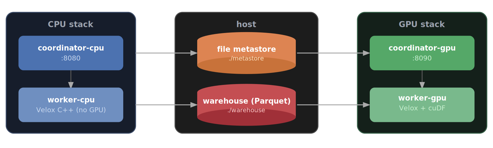

# Add GPU-acceleration to existing Presto cluster — Jupyter notebooks

This prestorial is a set of Jupyter notebooks that build up a working system step by step:

1. start a **CPU** Presto native C++ (Java coordinator + [native C++](https://github.com/facebookincubator/velox) worker),
2. load a real dataset — IBM's synthetic [Anti-Money-Laundering dataset](https://www.kaggle.com/datasets/ealtman2019/ibm-transactions-for-anti-money-laundering-aml) (~180M transactions),
3. start a **GPU** Presto C++ cluster ([native](https://github.com/facebookincubator/velox) + [cuDF](https://docs.rapids.ai/api/cudf/stable/)) **beside** the CPU cluster, sharing the same metastore and warehouse read-only — then run the same query on both engines and compare.

| | Notebook | Description | Engine |
|---|---|---|---|
| **1** | [`01_presto_cpu.ipynb`](01_presto_cpu.ipynb) | Start a **CPU** Presto cluster and smoke-test w/ external Parquet table | CPU |
| **2** | [`02_aml_demo.ipynb`](02_aml_demo.ipynb) | Convert the IBM AML dataset (~180M rows) to Parquet, create the table, and run queries | CPU |
| **3** | [`03_add_gpu.ipynb`](03_add_gpu.ipynb) | Add a **GPU** engine (native + cuDF) beside the CPU engine and run the same queries on both CPU and GPU engines | GPU |

## The two stacks

Both stacks share the host `metastore/` and `warehouse/` directories, but the GPU stack mounts them **read-only**: the CPU stack produces the data, the GPU stack analyzes it.

|  | **CPU stack** | **GPU stack** |
|---|---|---|
| compose file | `docker-compose-presto-native.yaml` | `docker-compose-presto-GPU.yaml` |
| compose project | `prestodb-cpu` | `prestodb-gpu` |
| coordinator image | `prestodb/presto:latest` | `prestodb/presto:coordinator-gpu-nightly` |
| worker image | `prestodb/presto-native:latest` | `prestodb/presto-native:gpu-nightly` (cuDF) |
| coordinator host port | **8080** | **8090** |
| worker host port | 8082 | 8092 |
| `metastore/` + `warehouse/` | mounted read-write | mounted **read-only** (`:ro`) |
| GPU reservation | — | `device_ids: ["0"]`, `capabilities: [gpu]` |

The GPU images are experimental, expected to change often, and provided for development, research or enthusiasts — see the compose-only [GPU-accelerated Presto C++ prestorial](../gpu) for a standalone GPU cluster and more detail on the cuDF session properties.

## Requirements

In addition to the [general requirements](/readme.md) of this repository:

- An NVIDIA GPU with up-to-date drivers, and the [NVIDIA Container Toolkit](https://docs.nvidia.com/datacenter/cloud-native/container-toolkit/latest/install-guide.html) so Docker can expose the GPU to the worker container (only needed for notebook 3)
- Python ≥ 3.11 for the notebooks

Confirm the GPU is visible to Docker with:

    docker run --rm --gpus all nvidia/cuda:12.4.1-base-ubuntu22.04 nvidia-smi

## Getting started

Install the Python dependencies and start JupyterLab from this directory:

    # with uv
    uv sync
    uv run jupyter lab

    # or with pip
    pip install jupyterlab jupyterlab-nvdashboard polars presto-python-client
    jupyter lab

Then run the notebooks in order. `jupyterlab-nvdashboard` is optional — it adds live GPU utilization dashboards to JupyterLab, useful while running notebook 3.

## The dataset

Notebook 2 uses IBM's synthetic [Anti-Money-Laundering dataset](https://www.kaggle.com/datasets/ealtman2019/ibm-transactions-for-anti-money-laundering-aml) (`HI-Large_Trans.csv`, ~180M rows). Download it from Kaggle yourself (free account required) — no data is redistributed by this repository. The notebook converts the CSV to snake_cased, timestamp-parsed snappy Parquet with one streaming [polars](https://pola.rs) pass (~2 min) and registers it as an external Hive table.

## Credits

Adapted from [will-hill/Presto-native-cuDF-Notebooks](https://github.com/will-hill/Presto-native-cuDF-Notebooks). A video walk-through is planned in collaboration with IBM.
